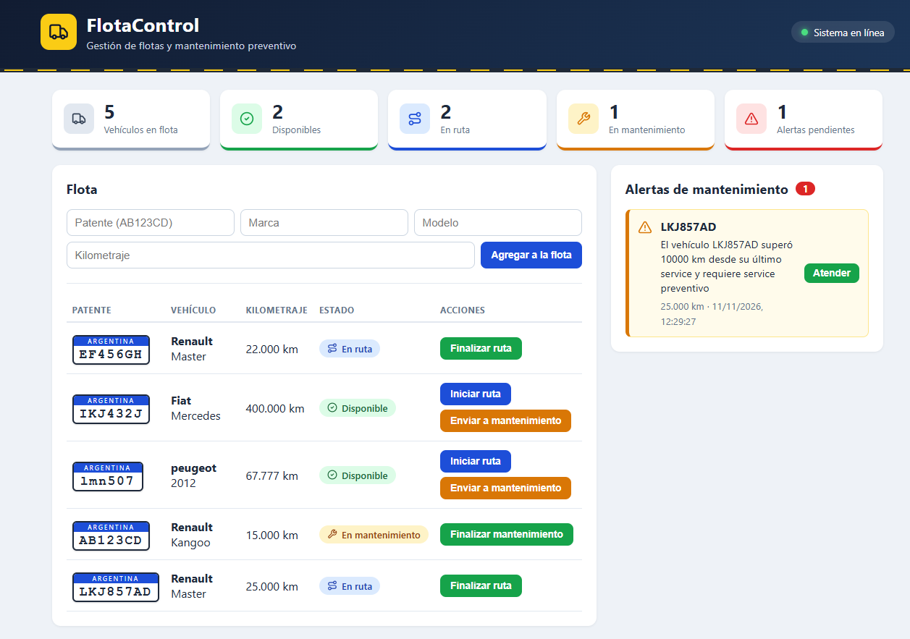
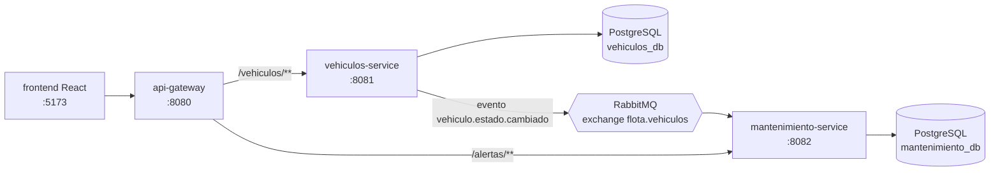
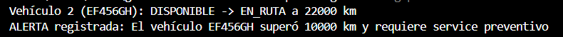

# FlotaControl: Sistema de Gestión de Flotas y Mantenimiento Preventivo


Sistema de microservicios para monitorear vehículos de una flota y automatizar alertas de mantenimiento preventivo. Cada cambio de estado de un vehículo se publica como un evento y el servicio de mantenimiento reacciona a él, sin que los servicios se conozcan entre sí. Incluye un panel web en React que muestra la flota y las alertas en tiempo real.



> Proyecto de portfolio en desarrollo. El roadmap al final detalla lo que falta.

## Arquitectura



| Módulo | Puerto | Responsabilidad |
|---|---|---|
| `frontend` | 5173 | Panel web en React: flota, estados, acciones y alertas. En desarrollo, Vite reenvía las llamadas al gateway. |
| `api-gateway` | 8080 | Puerta de entrada. Enruta `/vehiculos/**` hacia `vehiculos-service` y `/alertas/**` hacia `mantenimiento-service`. |
| `vehiculos-service` | 8081 | Gestiona los vehículos y su ciclo de vida. Persiste en su propia base PostgreSQL y publica eventos. |
| `mantenimiento-service` | 8082 | Consume los eventos de cambio de estado, registra alertas de mantenimiento preventivo en su propia base y las expone por API. |

Cada servicio tiene **su propia base de datos**: no comparten tablas y solo se comunican por eventos.

## Stack

- Java 17, Spring Boot 3.5, Spring Cloud 2025.0 (Gateway)
- Maven multimódulo (POM padre con dependencias centralizadas)
- PostgreSQL 16 y Spring Data JPA / Hibernate
- RabbitMQ 3 (Spring AMQP) para mensajería asíncrona
- React y Vite para el frontend
- JUnit 5 y AssertJ
- Docker, Docker Compose y GitHub Actions (CI)

## Decisiones de diseño

### Patrón State (GoF) para el ciclo de vida del vehículo

Un vehículo se comporta distinto según su estado. En lugar de condicionales (`if estado == ...`) repetidos en cada método, cada estado es una clase que implementa `EstadoVehiculo` y decide qué transiciones permite.

| Estado actual | Acción | Estado siguiente |
|---|---|---|
| Disponible | iniciar ruta | En Ruta |
| Disponible | enviar a mantenimiento | En Mantenimiento |
| En Ruta | finalizar ruta | Disponible |
| En Mantenimiento | finalizar mantenimiento | Disponible |

Cualquier otra combinación lanza `IllegalStateException`, que la API traduce a un `409 Conflict`. Agregar un estado nuevo es agregar una clase, sin tocar `Vehiculo`. El frontend refleja la misma regla: cada vehículo muestra solo los botones de las acciones válidas para su estado.

Los estados no guardan datos, así que son singletons (`INSTANCIA`) y cada transición devuelve el estado siguiente en lugar de modificar a la entidad.

### Persistencia del estado con `AttributeConverter`

El campo `estado` de la entidad `Vehiculo` es un objeto, pero en la base se guarda como texto (`DISPONIBLE`, `EN_RUTA`, `EN_MANTENIMIENTO`). `EstadoVehiculoConverter` hace la conversión en las dos direcciones y falla de forma explícita si encuentra un texto desconocido.

### Comunicación asíncrona por eventos

Cuando un vehículo cambia de estado, `vehiculos-service` publica un evento en el exchange `flota.vehiculos` (tipo *topic*) con la routing key `vehiculo.estado.cambiado`. `mantenimiento-service` tiene su propia cola enlazada a esa key.

```json
{
  "vehiculoId": 1,
  "patente": "AB123CD",
  "estadoAnterior": "DISPONIBLE",
  "estadoNuevo": "EN_RUTA",
  "kilometraje": 15000,
  "ocurridoEn": "2026-11-01T00:12:55.114Z"
}
```

- El evento se publica **después** de guardar y solo si la transición fue válida, así que nunca se informa de un cambio que no ocurrió.
- Cada servicio tiene **su propia copia** del evento, para que no compartan código y se puedan desplegar por separado.
- Si `mantenimiento-service` no está disponible, los mensajes esperan en la cola y se consumen cuando vuelve.

### Alertas de mantenimiento preventivo

`mantenimiento-service` registra una alerta cuando un vehículo recorre **10.000 km o más desde su último service**.

- Cuando un vehículo **sale de mantenimiento**, se guarda el kilometraje de ese service y se cierran sus alertas abiertas.
- Se mantiene **una sola alerta abierta por vehículo**: mientras la anterior no se atienda, los nuevos cambios de estado no generan duplicados.

```
Vehículo 2 (EF456GH): DISPONIBLE -> EN_RUTA a 22000 km
ALERTA registrada: El vehículo EF456GH superó 10000 km desde su último service y requiere service preventivo
```



### Manejo de errores

- Una transición inválida responde `409 Conflict` con un mensaje claro.
- Una patente repetida también responde `409 Conflict` (la base tiene una restricción de unicidad), en lugar de un error 500.
- Un vehículo inexistente responde `404`.

## Estructura del proyecto

```
gestionFlotas/
├── pom.xml                      # POM padre
├── Dockerfile                   # imagen de cada servicio (ARG MODULE)
├── docker-compose.yml           # bases, RabbitMQ y los tres servicios
├── docs/                        # capturas para el README
├── .github/workflows/ci.yml     # tests en cada push
├── frontend/                    # React + Vite
│   └── src/
│       ├── api.js               # llamadas al backend
│       └── components/          # flota, alertas y resumen
├── api-gateway/
├── vehiculos-service/
│   └── src/main/java/com/flota/vehiculos/
│       ├── api/                 # controller y DTOs
│       ├── domain/              # entidad Vehiculo
│       │   └── estado/          # patrón State
│       ├── messaging/           # publicación de eventos
│       └── persistence/         # repositorio y converter
└── mantenimiento-service/
    └── src/main/java/com/flota/mantenimiento/
        ├── api/                 # controller y DTOs de alertas
        ├── domain/              # entidades Alerta y UltimoService
        ├── messaging/           # consumo de eventos
        └── persistence/         # repositorios
```

## Cómo levantarlo

### Requisitos

- JDK 17 o superior
- Maven 3.9+
- Docker Desktop
- Node 20 o superior (solo para el frontend)

### Con Docker (recomendado)

Desde la raíz del repositorio:

```bash
mvn -DskipTests package
docker compose up -d --build
```

Levanta las dos bases PostgreSQL, RabbitMQ y los tres servicios. Hace falta compilar antes con Maven porque el `Dockerfile` copia los JAR desde `target/`. Los servicios pueden tardar en arrancar, según la máquina (cada JVM está limitada a 256 MB en el compose para equipos con poca memoria). Se puede seguir el arranque con `docker compose logs -f api-gateway` hasta ver `Started ApiGatewayApplication`.

Solo el gateway publica un puerto hacia afuera (`http://localhost:8080`). El panel de RabbitMQ está en http://localhost:15672. Las credenciales de desarrollo son `flota` / `flota123`.

### Frontend

Con el backend arriba, en otra terminal:

```bash
cd frontend
npm install
npm run dev
```

Se abre en http://localhost:5173. Vite reenvía las llamadas `/vehiculos` y `/alertas` al gateway (puerto 8080), así que no hace falta configurar CORS. El encabezado indica si el sistema está en línea y la pantalla se actualiza sola cada pocos segundos.

### Sin Docker para los servicios

Solo la infraestructura en Docker, y los servicios con Maven, cada uno en su terminal:

```bash
docker compose up -d postgres-vehiculos postgres-mantenimiento rabbitmq
mvn -pl vehiculos-service spring-boot:run
mvn -pl mantenimiento-service spring-boot:run
mvn -pl api-gateway spring-boot:run
```

Los `application.yml` apuntan a `localhost` por defecto (bases en los puertos 5433 y 5434), así que no hace falta configurar nada.

### Tests

```bash
mvn -pl vehiculos-service test
```

Son 22 tests unitarios (no necesitan Docker): las transiciones válidas e inválidas de cada estado, el ciclo de vida de `Vehiculo` y el converter. Se ejecutan automáticamente en cada `push` con GitHub Actions.

## API

Todas las rutas se consumen por el gateway (`http://localhost:8080`).

### Vehículos

| Método | Ruta | Descripción |
|---|---|---|
| `POST` | `/vehiculos` | Crea un vehículo (nace `DISPONIBLE`). Patente repetida: `409`. |
| `GET` | `/vehiculos` | Lista los vehículos. |
| `GET` | `/vehiculos/{id}` | Consulta un vehículo. |
| `POST` | `/vehiculos/{id}/iniciar-ruta` | `DISPONIBLE` → `EN_RUTA`. |
| `POST` | `/vehiculos/{id}/finalizar-ruta` | `EN_RUTA` → `DISPONIBLE`. |
| `POST` | `/vehiculos/{id}/enviar-a-mantenimiento` | `DISPONIBLE` → `EN_MANTENIMIENTO`. |
| `POST` | `/vehiculos/{id}/finalizar-mantenimiento` | `EN_MANTENIMIENTO` → `DISPONIBLE`. |

Una transición inválida responde `409 Conflict`; un vehículo inexistente, `404`.

### Alertas

| Método | Ruta | Descripción |
|---|---|---|
| `GET` | `/alertas` | Lista las alertas, la más reciente primero (filtro opcional `?atendida=false`). |
| `POST` | `/alertas/{id}/atender` | Marca una alerta como atendida. |

### Ejemplo

```powershell
# Crear un vehículo
Invoke-RestMethod -Method Post -Uri http://localhost:8080/vehiculos `
  -ContentType "application/json" `
  -Body '{"patente":"AB123CD","marca":"Renault","modelo":"Kangoo","kilometraje":15000}'

# Iniciar ruta (publica un evento y dispara la alerta en mantenimiento-service)
Invoke-RestMethod -Method Post -Uri http://localhost:8080/vehiculos/1/iniciar-ruta

# Consultar las alertas pendientes
Invoke-RestMethod -Uri "http://localhost:8080/alertas?atendida=false"

# Marcar una alerta como atendida
Invoke-RestMethod -Method Post -Uri http://localhost:8080/alertas/1/atender
```

## Limitaciones conocidas

- El kilometraje se carga al crear el vehículo y no se puede actualizar, así que la regla de "10.000 km desde el último service" se ve en acción una sola vez por vehículo.
- Las tablas se crean con `ddl-auto: update`, que es práctico para desarrollar pero no para producción.
- El frontend se ejecuta en desarrollo con Vite y todavía no está dockerizado.

## Roadmap

- [x] Maven multimódulo con tres servicios y gateway
- [x] Patrón State con persistencia por `AttributeConverter`
- [x] Eventos de cambio de estado por RabbitMQ
- [x] Tests unitarios del dominio
- [x] Persistir las alertas en `mantenimiento-service` y exponerlas por API
- [x] Ruta de `mantenimiento-service` en el gateway
- [x] Dockerizar los tres servicios en el `docker-compose.yml`
- [x] GitHub Actions: correr los tests en cada `push`
- [x] Frontend en React con panel de flota y alertas
- [ ] Actualizar el kilometraje de un vehículo (endpoint y evento) para recalcular alertas
- [ ] Demo en línea del sistema
- [ ] Tests de integración con Testcontainers
- [ ] Migraciones con Flyway en lugar de `ddl-auto: update`
- [ ] Dockerizar el frontend con nginx
- [ ] Descubrimiento de servicios y configuración centralizada (Spring Cloud)

## Autora

**Lucía Duarte**, estudiante de Ingeniería en Sistemas de Información (UTN FRC, Córdoba).
[GitHub](https://github.com/luciaduarte12) · [LinkedIn](https://www.linkedin.com/in/lucia-duarte-712b3223a/)