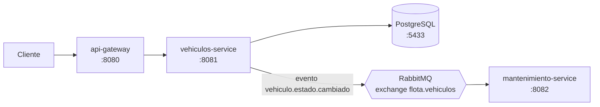

# Sistema de Gestión de Flotas y Mantenimiento Preventivo

Sistema de microservicios para monitorear vehículos de una flota y automatizar alertas de mantenimiento preventivo. Cada cambio de estado de un vehículo se publica como un evento y el servicio de mantenimiento reacciona a él, sin que los servicios se conozcan entre sí.

> Proyecto de portfolio. Está en desarrollo: el roadmap al final detalla lo que falta.

## Arquitectura



| Módulo | Puerto | Responsabilidad |
|---|---|---|
| `api-gateway` | 8080 | Puerta de entrada. Enruta `/vehiculos/**` hacia `vehiculos-service`. |
| `vehiculos-service` | 8081 | Gestiona los vehículos y su ciclo de vida. Persiste en PostgreSQL y publica eventos. |
| `mantenimiento-service` | 8082 | Consume los eventos de cambio de estado y aplica reglas de mantenimiento preventivo. |

## Stack

- Java 17, Spring Boot 3.5, Spring Cloud 2025.0 (Gateway)
- Maven multimódulo (POM padre con dependencias centralizadas)
- PostgreSQL 16 y Spring Data JPA / Hibernate
- RabbitMQ 3 (Spring AMQP) para mensajería asíncrona
- JUnit 5 y AssertJ
- Docker Compose para la infraestructura local

## Decisiones de diseño

### Patrón State (GoF) para el ciclo de vida del vehículo

Un vehículo se comporta distinto según su estado. En lugar de condicionales (`if estado == ...`) repetidos en cada método, cada estado es una clase que implementa `EstadoVehiculo` y decide qué transiciones permite.

| Estado actual | Acción | Estado siguiente |
|---|---|---|
| Disponible | iniciar ruta | En Ruta |
| Disponible | enviar a mantenimiento | En Mantenimiento |
| En Ruta | finalizar ruta | Disponible |
| En Mantenimiento | finalizar mantenimiento | Disponible |

Cualquier otra combinación lanza `IllegalStateException`, que la API traduce a un `409 Conflict`. Agregar un estado nuevo es agregar una clase, sin tocar `Vehiculo`.

Los estados no guardan datos, así que son singletons (`INSTANCIA`) y cada transición devuelve el estado siguiente en lugar de modificar a la entidad.

### Persistencia del estado con `AttributeConverter`

El campo `estado` de la entidad `Vehiculo` es un objeto, pero en la base se guarda como texto (`DISPONIBLE`, `EN_RUTA`, `EN_MANTENIMIENTO`). `EstadoVehiculoConverter` hace la conversión en las dos direcciones, y falla de forma explícita si encuentra un texto desconocido.

### Comunicación asíncrona por eventos

Cuando un vehículo cambia de estado, `vehiculos-service` publica un evento en el exchange `flota.vehiculos` (tipo *topic*) con la routing key `vehiculo.estado.cambiado`. `mantenimiento-service` tiene su propia cola enlazada a esa key.

```json
{
  "vehiculoId": 1,
  "patente": "AB123CD",
  "estadoAnterior": "DISPONIBLE",
  "estadoNuevo": "EN_RUTA",
  "kilometraje": 15000,
  "ocurridoEn": "2026-11-01T00:12:55.114Z"
}
```

- El evento se publica **después** de guardar y solo si la transición fue válida, así que nunca se informa de un cambio que no ocurrió.
- Cada servicio tiene **su propia copia** del evento, para que no compartan código y se puedan desplegar por separado.

### Regla de mantenimiento preventivo

`mantenimiento-service` registra una alerta cuando el kilometraje del vehículo supera los 10.000 km:

```
Vehículo 1 (AB123CD): DISPONIBLE -> EN_RUTA a 15000 km
ALERTA: el vehículo 1 (AB123CD) superó 10000 km y requiere service preventivo
```

## Estructura del proyecto

```
gestionFlotas/
├── pom.xml                      # POM padre
├── docker-compose.yml           # PostgreSQL y RabbitMQ
├── api-gateway/
├── vehiculos-service/
│   └── src/main/java/com/flota/vehiculos/
│       ├── api/                 # controller y DTOs
│       ├── domain/              # entidad Vehiculo
│       │   └── estado/          # patrón State
│       ├── messaging/           # publicación de eventos
│       └── persistence/         # repositorio y converter
└── mantenimiento-service/
    └── src/main/java/com/flota/mantenimiento/
        └── messaging/           # consumo de eventos
```

## Cómo levantarlo

### Requisitos

- JDK 17 o superior
- Maven 3.9+
- Docker Desktop

### 1. Infraestructura

```bash
docker compose up -d
```

Levanta PostgreSQL (puerto 5433) y RabbitMQ (puerto 5672, panel en http://localhost:15672). Las credenciales de desarrollo son `flota` / `flota123`.

### 2. Servicios

En tres terminales distintas, desde la raíz:

```bash
mvn -pl vehiculos-service spring-boot:run
mvn -pl mantenimiento-service spring-boot:run
mvn -pl api-gateway spring-boot:run
```

### 3. Tests

```bash
mvn -pl vehiculos-service test
```

Son 22 tests unitarios (no necesitan Docker): las transiciones válidas e inválidas de cada estado, el ciclo de vida de `Vehiculo` y el converter.

## API

Todas las rutas se pueden consumir por el gateway (`http://localhost:8080`) o directamente en `vehiculos-service` (`:8081`).

| Método | Ruta | Descripción |
|---|---|---|
| `POST` | `/vehiculos` | Crea un vehículo (nace `DISPONIBLE`). |
| `GET` | `/vehiculos` | Lista los vehículos. |
| `GET` | `/vehiculos/{id}` | Consulta un vehículo. |
| `POST` | `/vehiculos/{id}/iniciar-ruta` | `DISPONIBLE` → `EN_RUTA`. |
| `POST` | `/vehiculos/{id}/finalizar-ruta` | `EN_RUTA` → `DISPONIBLE`. |
| `POST` | `/vehiculos/{id}/enviar-a-mantenimiento` | `DISPONIBLE` → `EN_MANTENIMIENTO`. |
| `POST` | `/vehiculos/{id}/finalizar-mantenimiento` | `EN_MANTENIMIENTO` → `DISPONIBLE`. |

Una transición inválida responde `409 Conflict`; un vehículo inexistente, `404`.

### Ejemplo

```powershell
# Crear un vehículo
Invoke-RestMethod -Method Post -Uri http://localhost:8080/vehiculos `
  -ContentType "application/json" `
  -Body '{"patente":"AB123CD","marca":"Renault","modelo":"Kangoo","kilometraje":15000}'

# Iniciar ruta (publica un evento y dispara la alerta en mantenimiento-service)
Invoke-RestMethod -Method Post -Uri http://localhost:8080/vehiculos/1/iniciar-ruta
```

## Roadmap

- [x] Maven multimódulo con tres servicios y gateway
- [x] Patrón State con persistencia por `AttributeConverter`
- [x] Eventos de cambio de estado por RabbitMQ
- [x] Tests unitarios del dominio
- [ ] Persistir las alertas en `mantenimiento-service` y exponerlas por API
- [ ] Ruta de `mantenimiento-service` en el gateway
- [ ] Tests de integración con Testcontainers
- [ ] Dockerizar los tres servicios en el `docker-compose.yml`
- [ ] Migraciones con Flyway en lugar de `ddl-auto: update`
- [ ] Descubrimiento de servicios y configuración centralizada (Spring Cloud)

## Autora

**Lucía Duarte**, estudiante de Ingeniería en Sistemas de Información (UTN FRC, Córdoba).
[GitHub](https://github.com/luciaduarte12)